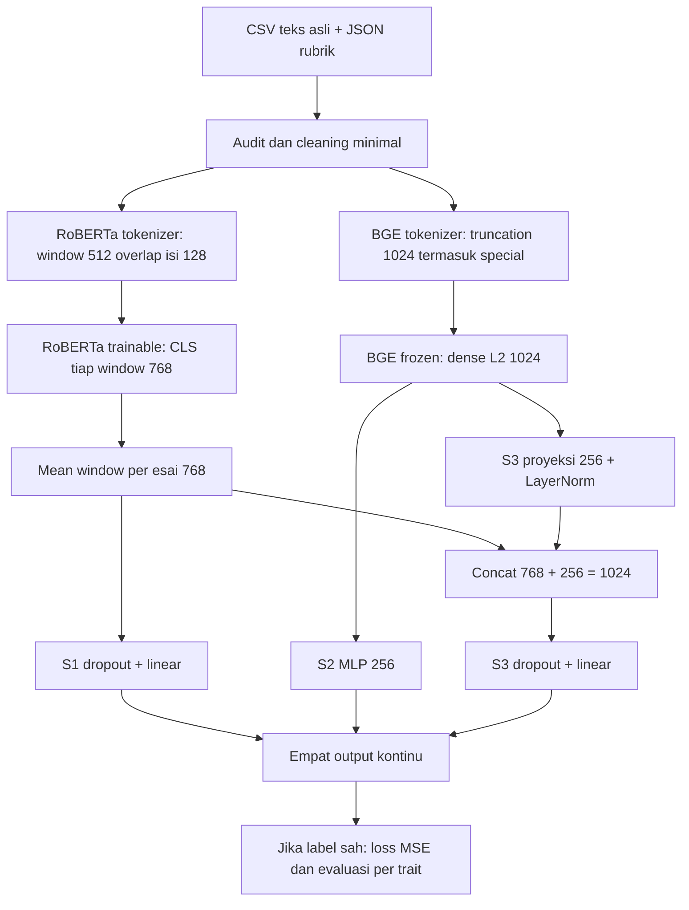

# Dari teks sampai empat prediksi

> Dokumen tahap terdahulu. Angka dan keputusan dibaca dalam konteks versi ini; untuk kondisi aktif gunakan [status proyek](../../STATUS_PROYEK.md) dan [panduan AI](../../PANDUAN_AI_PROYEK.md).

**Trait** adalah aspek penilaian: isi, organisasi, kebahasaan, mekanik. **Label** adalah skor guru yang menjadi jawaban saat belajar. Label saat ini kosong; jangan menggantinya dengan nol. Model membaca teks saja, bukan nilai huruf, topic, identitas atau status.

**Tokenisasi** memecah teks menjadi satuan yang dikenal encoder. Token ID adalah nomor kamus, bukan mutu esai. **Embedding** adalah vektor angka representasi konteks, bukan skor rubrik. Encoder pretrained sudah belajar pola bahasa sebelumnya; head skor baru belum belajar penilaian guru.

**Shape** adalah ukuran tensor (array angka). B adalah jumlah esai dalam batch. `[1,1024]` berarti satu esai dengan 1024 fitur BGE. RoBERTa memberi `[jumlah_window,512_atau_kurang,768]`; ambil token pertama menjadi `[jumlah_window,768]`, lalu rata-rata berdasarkan `chunk_to_essay` menjadi `[B,768]`. S3 memproyeksikan BGE ke `[B,256]`, menyambung menjadi `[B,1024]`, dan menghasilkan `[B,4]`. Kolom output selalu isi, organisasi, kebahasaan, mekanik. Label juga `[B,4]`, tidak dibroadcast dari satu angka.

Contoh **ilustrasi matematika, bukan label CSV**: prediksi `[2,3,4,5]` dan label uji `[3,3,3,5]` memberi MSE `(1+0+1+0)/4 = 0.5`. Tidak ada loss penelitian untuk data yang belum dinilai.

**Frozen** berarti bobot tidak diperbarui: BGE eval, tanpa graph gradien, boleh dicache. **Fine-tuning** memperbarui bobot RoBERTa berdasarkan loss; mean window tetap differentiable, sehingga semua window menyumbang gradien. **Gradien** adalah arah perubahan parameter untuk mengurangi loss. Proyeksi/LayerNorm/head S3 ikut diperbarui dan tidak menjadi bagian cache BGE. Empat output berbagi representasi: kesalahan trait tidak otomatis independen.

**Chunk/window** adalah bagian token esai panjang; bukan observasi berlabel tersendiri. **Micro-batch** adalah kelompok kecil esai yang dimuat sekaligus. Gradien beberapa micro-batch dikumpulkan sampai effective batch delapan esai, lalu satu **optimizer step** memperbarui bobot. **Epoch** adalah satu lintasan seluruh esai train. Delapan chunk bukan effective batch delapan esai.

**Fold** membagi development menjadi train/validation. Split dilakukan sebelum tokenisasi window. Versi esai/siswa/duplikasi terkait harus berada pada group yang sama agar informasi tidak bocor. Group saat ini hanya usulan kemiripan, perlu review manusia. Test disimpan untuk sekali penilaian setelah konfigurasi terkunci.

Output kontinu boleh keluar dari 1–5 ketika head linear belum cocok. RMSE memakai selisih kontinu dalam unit skor; Pearson mengukur hubungan linear. QWK dan AC2 mengukur agreement ordinal setelah salinan prediksi di-clip dan dipetakan ke kategori terdekat; kategori midpoint memilih yang rendah. Nilai UNTRAINED dari notebook hanya untuk melihat alur dan shape, bukan skor siswa.

Notebook berurutan: konfigurasi → audit → esai/status/deskriptor → cleaning → token IDs/window → embedding/shapes/UNTRAINED → frozen/gradien → guard supervised → langkah setelah skor guru. Modul `inspection` mengorkestrasi contoh; `io/audit` memeriksa sumber, `windows` membagi/agregasi, `encoders` mengunduh/check/cache, `model` membentuk head, `trainer/experiment` belajar dan split, `metrics` menghitung empat metrik, `checkpoint/inference` memuat model terlatih.
